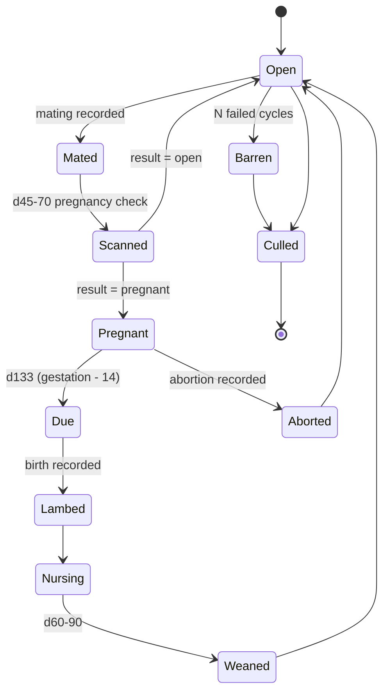

# نَسْل · Nasl — Flock Management

### Product scope & requirements · v0.1 draft

> **Every ewe has a career. Nobody is keeping her record.**
>
> An Arabic-first, offline-first flock manager built around the breeding female — her matings,
> pregnancies, lambings, milk, medicines and line — with a React Native (Expo) app for the herder
> and a React web console on a shared Node/Express/MongoDB backend.

|                    |                            |
| ------------------ | -------------------------- |
| **Status**         | Draft for review           |
| **Stack**          | MERN + Expo (React Native) |
| **Primary market** | Gulf & Levant              |
| **Benchmark**      | مقاني Mqane                |

---

## Contents

1. [What exists today](#1-what-exists-today)
2. [The gap](#2-the-gap)
3. [The name](#3-the-name)
4. [Product definition](#4-product-definition)
5. [Who uses it](#5-who-uses-it)
6. [The ewe cycle](#6-the-ewe-cycle)
7. [Functional requirements](#7-functional-requirements)
8. [Web admin panel](#8-web-admin-panel)
9. [Data model](#9-data-model)
10. [Architecture & sync](#10-architecture--sync)
11. [Non-functional requirements](#11-non-functional-requirements)
12. [Success metrics](#12-success-metrics)
13. [Roadmap](#13-roadmap)
14. [Risks & open questions](#14-risks--open-questions)
15. [Sources](#15-sources)

---

## 1. What exists today

**مقاني (Mqane) is real and shipping.** It is a Saudi product by [Nami Tech](https://nami-tec.com/ar/portfolio/9),
built on **Laravel with a Flutter client**, published on both stores and the web. Its pitch is the
**مراح** — the sheep fold: register your **حلال** (livestock), keep health data, run care schedules,
record vaccinations, illnesses and births. It sells at roughly **12 SAR/month (~$3.20)**, which is the
price anchor for a Gulf smallholder. It is on version 6.3 with a thin public review base (4.0 from
4 ratings on the App Store), and its marketing site was unreachable during this scan.

It is a credible incumbent for _record-keeping_. It is not a breeding system.

### The field

| Product                           | Origin       | Reach               | What it is actually good at                                                                                                                            | Price               |
| --------------------------------- | ------------ | ------------------- | ------------------------------------------------------------------------------------------------------------------------------------------------------ | ------------------- |
| **مقاني Mqane**                   | Saudi        | iOS · Android · Web | Fold-centric records: animals, health data, vaccination & disease log, births, care schedules. Arabic-native.                                          | ~12 SAR/mo          |
| **Greener Herd**                  | Dubai        | iOS · Android       | Arabic-first, but aimed upmarket: feed/nutrition optimisation, health, supplies marketplace, first regional emissions tracker.                         | ~$100/mo @400 head  |
| **مواشي برو Mawashi Pro**         | Gulf         | iOS only            | Animals, health, reproduction & births, income/expenses. **Hijri and Gregorian calendars** — the only one that gets this right.                        | —                   |
| **إدارة المواشي**                 | —            | iOS · Android       | Animal profiles (ear no., type, age, weight), births, herds, vaccination reminders, per-animal medical file. Claims 1,000+ farms.                      | Free                |
| **My Sheep Manager**              | Kenya        | iOS · Android · Web | **Closest functional benchmark.** Mating → pregnancy → lambing → lineage, weights, finance, PDF/CSV export, roles, offline. 4.5★ / 297 reviews.        | Free ≤25 · $9.99/mo |
| **Herdwatch**                     | IE / UK / US | iOS · Android · Web | Compliance-grade medicine book and digital lambing book, breeding groups, weights, multi-user, offline sync, spreadsheet import.                       | Quote               |
| **FlockFinder**                   | UK           | iOS · Android       | Medicine book, lineage, lambing performance, field mapping and stocking rates, **Bluetooth EID stick readers**, free seats for farm staff.             | Trial + plans       |
| **Farmbrite · FarmKeep · Folio3** | US           | Web-first           | Livestock ERP breadth — pedigree validation, lambing %, mortality, genetic trend. English, desk-shaped, priced for commercial operations.              | $$                  |
| **نما Naama · أنعام بلس**         | Saudi (MEWA) | Gov. portal         | Not competitors — the destination. Livestock numbering **ترقيم الماشية** and the breeder record **سجل المربي** that gate access to subsidy programmes. | Gov.                |

---

## 2. The gap

The market splits cleanly. Arabic products are warm, cheap and shallow. English products are deep,
cold and priced for someone else. Seven specific openings sit in between.

| #      | Gap                                                 | Why it matters                                                                                                                                                                                                                          |
| ------ | --------------------------------------------------- | --------------------------------------------------------------------------------------------------------------------------------------------------------------------------------------------------------------------------------------- |
| **G1** | **The ewe is not a first-class object anywhere.**   | Arabic apps model an _animal_ with a health log attached. But the economic unit of a sheep operation is a female's reproductive career — lambs per lambing, lambing interval, kg weaned per year. Without that, culling is guesswork.   |
| **G2** | **Pedigree stops at one generation, or is absent.** | Buyers of breeding stock in the Gulf pay for line (النسب). No Arabic app renders a real multi-generation tree or warns on inbreeding.                                                                                                   |
| **G3** | **No medicine withdrawal enforcement.**             | Antibiotics and anthelmintics carry meat and milk withholding periods. An animal treated on Tuesday must not be slaughtered on Friday. Herdwatch and FlockFinder treat this as the core feature; the Arabic apps do not have it at all. |
| **G4** | **Offline is inconsistent.**                        | Grazing land in Najd, the Badia and the Maghreb has no signal. Any app that needs a request to save a birth loses the record.                                                                                                           |
| **G5** | **The calendar is wrong.**                          | The customer's year runs on Hijri dates, Ramadan, and Eid al-Adha. Only Mawashi Pro supports التقويم الهجري, and none plan around the أضاحي selling season that sets annual revenue.                                                    |
| **G6** | **Zakat is computed on paper.**                     | Every owner of 40+ head owes زكاة الأنعام on a lunar cycle. The flock register already holds every input. Nobody joins them.                                                                                                            |
| **G7** | **No bridge to the compliance artefacts.**          | Numbering via نما and an active سجل مربي unlock real subsidy money. A clean, exportable flock register is the missing half of that paperwork.                                                                                           |

> **Positioning** — Mqane's price and Mqane's simplicity, with My Sheep Manager's reproductive depth
> and Herdwatch's medicine discipline, in Arabic, offline, on Hijri dates.
> **The wedge is the breeding female, not the herd roster.**

---

## 3. The name

# نَسْل · Nasl

**Progeny. Lineage. Breeding stock.** It is the exact word a herder uses for what a flock produces
across the years — and it names the product's core rather than its category.

- **It says what the app is for.** Not "livestock" or "herd" — _the line_. Births, pedigree and productivity are one idea in one word.
- **Four letters in both scripts**, one syllable in Latin, unambiguous to spell aloud in a WhatsApp group.
- **Ownable.** The generic names — مواشي, أنعام, حلال — are already crowded, and أنعام collides with the government's own platform. App-store search for Nasl returns no livestock product.
- **It works as a verb in marketing:** نَسْلك في جيبك — "your line, in your pocket."

### Alternates considered

| Name              | Meaning                                               | Verdict                                                                                                                                                           |
| ----------------- | ----------------------------------------------------- | ----------------------------------------------------------------------------------------------------------------------------------------------------------------- |
| **مِيسَم Meesam** | The identifying mark burned or tagged onto an animal. | Strong tie to tagging and identity. Slightly literary, and doubles as a personal name. → **runner-up**                                                            |
| **سَرْح Sarh**    | The flock released to graze at first light.           | Warm and pastoral, but weak in Latin script and easily misread as "Sarah". → no                                                                                   |
| **نِتاج Nitaj**   | The season's offspring and yield.                     | Arguably the best meaning of all — but [nitaj.om](https://nitaj.om/mobile/) is an established Omani animal-feed brand. Same industry, same region. → **conflict** |
| **مَرْعى Mar'a**  | Pasture.                                              | Generic, and describes the land rather than the animals. → no                                                                                                     |

> ⚠️ **Before committing** — clear `نسل` and `Nasl` through GCC trademark classes 9 and 42 and secure
> `nasl.app`; assume `nasl.com` is taken. Sanity-check the word with three native speakers per target
> dialect — نسل is standard Arabic but colloquial connotations vary.

---

## 4. Product definition

### Vision

A herder with 80 ewes and no notebook should be able to answer three questions in under ten seconds,
standing in the pen, with no signal:

> _Who is due this week? Who is still under a withdrawal period? Which ewes have earned their feed?_

### In scope for v1

Sheep (الضأن) and goats (الماعز). The data model is species-generic — gestation length, weaning age
and vaccination protocols are per-species configuration — so camels and cattle are a configuration
change, not a rewrite. But every default, term and screen is tuned for small ruminants at launch.

### Explicit non-goals for v1

- No livestock **marketplace or trading**. That is a separate business with separate trust problems, and أنعام and مربي already occupy it.
- No **IoT collars, smart scales or automatic weighing**. Bluetooth EID tag readers only, and only in Phase 2.
- No **feed formulation or ration science**. Log what was fed and what it cost; do not model nutrition.
- No **full accounting**. Sales, purchases and expenses per animal — not a ledger, not VAT filing.
- No **direct government API integration**. Produce the export a breeder needs; do not attempt to file on their behalf.

---

## 5. Who uses it

### The owner-herder — _primary, mobile_

60–300 head across one or two pens outside town. Comfortable in Arabic, impatient with typing, often
operating the phone one-handed. Currently keeps records in his head and a WhatsApp note to himself.
**Needs:** who is due, who is sick, who to cull.

### The hired shepherd الراعي — _primary, mobile_

Present at every birth and every treatment — the person who actually observes the events worth
recording. Frequently not an Arabic first-language speaker, sometimes functionally illiterate.
**Needs:** record an event with icons and a voice note, in under 20 seconds, with no free-text field required.

### The visiting vet البيطري — _secondary, mobile_

On site occasionally, under time pressure. Wants an animal's full treatment history in one screen and
wants to write the treatment before leaving the pen.
**Needs:** scoped, time-limited access to one farm.

### The commercial operator — _secondary, web_

1,000+ head, multiple sites, employees. Lives in exports and season-over-season comparisons rather
than in the pen.
**Needs:** the owner web console (Phase 2), staff seats, Excel out.

### Platform operator — _internal, web_

Our own support and ops. Handles subscriptions, curates the shared reference libraries (breeds,
vaccines, diseases, medicines), investigates issues.
**Needs:** the admin panel, with every privileged action audited.

---

## 6. The ewe cycle

This is the spine of the product. Every ewe carries one reproductive state; the state advances on
recorded events, and every alert the app raises is derived from it. Days are counted from mating,
using a per-species reference estimate — **147 days** for sheep, **150** for goats. Sheep display
a **day 145–152 inclusive lambing window** for planning; overdue starts after day 152. The stored
reference estimate remains available for existing records and health-protocol schedules.

```
  فارغة  →  مُلقَّحة  →  مفحوصة  →  حامل   →  قريبة الولادة →  والِدة  →  مُرضِعة →  مفطومة  ↻
   Open      Mated      Scanned   Pregnant       Due          Lambed    Nursing    Weaned
  day 0     mating     d45–70    confirmed      d133+          d147     0–75d     d60–90
```



**Key intervals**

|                         |                                             |
| ----------------------- | ------------------------------------------- |
| Estrous cycle           | 16–17 days                                  |
| Puberty                 | 6–9 months, or ~65% of mature weight        |
| Pregnancy scan window   | gestation d45–70                            |
| Pre-lambing booster     | gestation d105–119                          |
| Gestation               | Sheep planning window d145–152 · goats d150 |
| Weaning                 | d60–90                                      |
| Target lambing interval | 8 months (3 lambings / 2 years)             |

**Exception states:** فارغة (scan negative, returns to Open) · مُجهِضة (aborted) · عاقر (barren after
N cycles) · مُستبعدة (culled) · نافقة (dead).

Each transition is an **immutable event document**, never a field update. The ewe's current state is
derived from her event stream. This is what makes offline sync tractable (see §10) and what makes a
lifetime productivity record possible without a separate reporting pipeline.

---

## 7. Functional requirements

**Phase key:** `MVP` ships in v1 · `P2` next release · `P3` later.
Every requirement below is a mobile requirement unless marked otherwise; the web console mirrors reads
and adds bulk operations (§8).

### M1 · Flock registry سجل القطيع

| ID        | Requirement                                                                                                                                                            | Phase |
| --------- | ---------------------------------------------------------------------------------------------------------------------------------------------------------------------- | ----- |
| FR-REG-01 | Register an animal with tag number (رقم الأذن), species, breed, sex, date of birth (exact or estimated), colour/markings, and origin (born here / purchased / gifted). | MVP   |
| FR-REG-02 | Tag number is unique per farm and validated on entry; duplicates are rejected with the conflicting animal shown.                                                       | MVP   |
| FR-REG-03 | **Bulk registration mode** — a stripped keypad-only flow that adds one animal per 5 seconds while the herder works through a pen.                                      | MVP   |
| FR-REG-04 | Attach photos to an animal; capture, compress and queue offline.                                                                                                       | MVP   |
| FR-REG-05 | Search and filter the flock by tag, name, sex, breed, age band, group, reproductive state, and health flag.                                                            | MVP   |
| FR-REG-06 | Breed library seeded with regional breeds — نجدي، نعيمي، حري، عواسي، سواكني، بربري، هرفي; goats عارضي، شامي، جبلي — plus a free-text fallback.                         | MVP   |
| FR-REG-07 | Change an animal's status: active, sold, slaughtered, dead (with cause), culled, lost/stolen. Status changes are events, not deletions.                                | MVP   |
| FR-REG-08 | Import an existing flock from Excel/CSV with a column-mapping step and a dry-run preview.                                                                              | P2    |
| FR-REG-09 | Read an EID/RFID ear tag from a Bluetooth stick reader and open or create that animal.                                                                                 | P2    |
| FR-REG-10 | Capture a tag number by camera OCR as an alternative to typing.                                                                                                        | P3    |

### M2 · Breeding & reproduction التلقيح والحمل

| ID       | Requirement                                                                                                                                                               | Phase |
| -------- | ------------------------------------------------------------------------------------------------------------------------------------------------------------------------- | ----- |
| FR-BR-01 | Record a mating (سِفاد) for a ewe: sire, date or date range, method (natural service or AI). Expected due date is computed and shown immediately.                         | MVP   |
| FR-BR-02 | **Breeding groups** — assign a ram to a group of ewes for a tupping window; a birth later attributes paternity to that ram, or flags it uncertain if two rams overlapped. | MVP   |
| FR-BR-03 | Record a pregnancy check (فحص الحمل): date, method (ultrasound / manual / observation), result (pregnant, open, uncertain), and foetus count where scanned.               | MVP   |
| FR-BR-04 | A negative scan returns the ewe to Open and cancels the pending due-date alerts.                                                                                          | MVP   |
| FR-BR-05 | Foetus count drives feeding guidance and the drop-pen alert — twins and triplets are flagged separately from singles.                                                     | P2    |
| FR-BR-06 | Record abortion (إجهاض) with suspected cause; the ewe returns to Open and the event is retained in her career record.                                                     | MVP   |
| FR-BR-07 | Flag a ewe barren (عاقر) automatically after a configurable number of failed cycles, as a culling candidate.                                                              | P2    |
| FR-BR-08 | **Ram workload** — ewes covered per ram per season, conception rate by ram, and a warning when a ram exceeds a configured ewe:ram ratio.                                  | P2    |
| FR-BR-09 | Body condition score (درجة السمنة) on a 1–5 scale at mating and pre-lambing, recorded against the ewe.                                                                    | P2    |
| FR-BR-10 | Season planner: set a tupping window and the app back-calculates the lambing window, the scan window, and the pre-lambing vaccination date.                               | P3    |

### M3 · Lambing الولادة

| ID        | Requirement                                                                                                                                                              | Phase |
| --------- | ------------------------------------------------------------------------------------------------------------------------------------------------------------------------ | ----- |
| FR-LMB-01 | Record a birth against the dam in one flow: date, birth type (single / twin / triplet / quad), and one row per lamb.                                                     | MVP   |
| FR-LMB-02 | Per lamb: sex, birth weight, outcome (live / stillborn / died within 24h), vigour, and optional tag number. Untagged lambs get a provisional ID and can be tagged later. | MVP   |
| FR-LMB-03 | Each live lamb is created as an animal with dam and sire links already set — no second data-entry step.                                                                  | MVP   |
| FR-LMB-04 | Record lambing difficulty (تعسّر الولادة) and whether assistance was needed; surface it in the dam's record as a culling signal.                                         | MVP   |
| FR-LMB-05 | Record mothering ability and udder condition (حالة الضرع), including mastitis and blind quarters.                                                                        | P2    |
| FR-LMB-06 | Record fostering — a lamb reared by a ewe other than its dam — keeping genetic and rearing dam distinct.                                                                 | P2    |
| FR-LMB-07 | Record weaning (الفطام) with date and weaning weight; the ewe returns to Open.                                                                                           | MVP   |
| FR-LMB-08 | Lambing book: a chronological, exportable record of every birth in a season.                                                                                             | MVP   |

### M4 · Pedigree شجرة النسب

| ID        | Requirement                                                                                                                                   | Phase |
| --------- | --------------------------------------------------------------------------------------------------------------------------------------------- | ----- |
| FR-PED-01 | Render an ancestor tree of at least 4 generations, pan-and-zoom, RTL-correct, from dam/sire links.                                            | MVP   |
| FR-PED-02 | Render descendants: all offspring of a ewe or ram, grouped by lambing.                                                                        | MVP   |
| FR-PED-03 | Support animals whose parents are unknown or off-farm, including purchased stock recorded by name only.                                       | MVP   |
| FR-PED-04 | **Inbreeding warning** — when proposing a mating, compute the coefficient of relationship and warn above a configurable threshold.            | P2    |
| FR-PED-05 | Reject cycles in the parentage graph (an animal cannot be its own ancestor) and reject a sire/dam whose sex or DOB makes the link impossible. | MVP   |
| FR-PED-06 | Export a pedigree certificate as a shareable PDF for stock sales.                                                                             | P2    |

### M5 · Health, medicines & treatments الصحة والعلاج

| ID        | Requirement                                                                                                                                                                                                                                                                                                                                                                                   | Phase |
| --------- | --------------------------------------------------------------------------------------------------------------------------------------------------------------------------------------------------------------------------------------------------------------------------------------------------------------------------------------------------------------------------------------------- | ----- |
| FR-HLT-01 | Record a health event against one animal or a whole group: vaccination, treatment, deworming, examination, injury, diagnosis.                                                                                                                                                                                                                                                                 | MVP   |
| FR-HLT-02 | Per event: product, dose and unit, route (IM / SC / oral / topical), batch number, administered by, cost, notes, photos.                                                                                                                                                                                                                                                                      | MVP   |
| FR-HLT-03 | **Withdrawal enforcement** — the product's meat and milk withholding days set a withhold-until date on the animal. The app blocks recording a sale or slaughter inside that window with a hard warning.                                                                                                                                                                                       | MVP   |
| FR-HLT-04 | A flock-wide "under withdrawal" view, so the herder can see at a glance which animals cannot be sold this week.                                                                                                                                                                                                                                                                               | MVP   |
| FR-HLT-05 | **Medicine cabinet** (خزانة الأدوية) — stock on hand per product with batch, expiry and unit cost; recording a treatment decrements stock; expiry and low-stock alerts.                                                                                                                                                                                                                       | P2    |
| FR-HLT-06 | Curated regional disease and vaccine library — PPR (طاعون المجترات الصغيرة), sheep pox (جدري الأغنام), FMD (الحمى القلاعية), enterotoxaemia (التسمم المعوي), brucellosis, pasteurellosis, mange (الجرب), internal parasites.                                                                                                                                                                  | MVP   |
| FR-HLT-07 | **Protocol engine** — a curated library of vaccination and drench programmes triggered by age, days pre-lambing, days post-partum, the dose that preceded them, or a yearly cycle, generating tasks for every eligible animal. Each protocol cites its source and is marked as farm-given or ministry-delivered; a disclaimer travels with it. Grouped by dose rather than listed per animal. | MVP   |
| FR-HLT-08 | FAMACHA score (1–5) recorded at handling, with a trend per animal and a flock anaemia view.                                                                                                                                                                                                                                                                                                   | P3    |
| FR-HLT-09 | Record mortality with cause and post-mortem notes; feed it into a mortality-rate report.                                                                                                                                                                                                                                                                                                      | MVP   |
| FR-HLT-10 | Full treatment history for one animal on a single screen, newest first, in under one second.                                                                                                                                                                                                                                                                                                  | MVP   |

### M7 · Milk & lactation الحليب والإدرار

| ID        | Requirement                                                                                                                                                                                                                          | Phase |
| --------- | ------------------------------------------------------------------------------------------------------------------------------------------------------------------------------------------------------------------------------------ | ----- |
| FR-MLK-01 | A lactation opens automatically when a birth is recorded, and closes on drying off or on the next lambing.                                                                                                                           | MVP   |
| FR-MLK-02 | **Test-day recording** — a whole-day yield per ewe on periodic test days, with the lactation estimated by the Fleischmann (test-interval) method. Re-entering a test day corrects it rather than adding a second.                    | MVP   |
| FR-MLK-03 | A ewe under a **milk** withdrawal is named back at the parlour. Her measurement is still recorded; her milk must not reach the tank.                                                                                                 | MVP   |
| FR-MLK-04 | Tank collections per session, as the flock's volume line independent of per-ewe testing.                                                                                                                                             | MVP   |
| FR-MLK-05 | Standardised 150-day yield, peak and days in milk per lactation; the milking flock ranked best first. Never extrapolates a lactation that has not run its course.                                                                    | MVP   |
| FR-MLK-06 | **Disposition** — what a batch of milk became: sold raw, set for cheese, soured for yogurt, or kept for the house. Reports what each route earned per kilogram of raw milk. Milk collected and never allocated is reported as a gap. | MVP   |
| FR-MLK-07 | Cheese and yogurt yields sanity-checked against sheep-milk ratios at the point of entry. The flag is a question, never a refusal.                                                                                                    | MVP   |
| FR-MLK-08 | Milk revenue appears in the profit and loss as its own line, read from the batch records.                                                                                                                                            | MVP   |
| FR-MLK-09 | Somatic cell count and mastitis history per ewe, feeding the culling signals.                                                                                                                                                        | P3    |

### M6 · Weights & growth الأوزان والنمو

| ID        | Requirement                                                                                                              | Phase |
| --------- | ------------------------------------------------------------------------------------------------------------------------ | ----- |
| FR-WGT-01 | Record a weight for an animal with date; support a rapid weigh-session mode that moves to the next animal automatically. | MVP   |
| FR-WGT-02 | Compute and display average daily gain between any two weighings.                                                        | MVP   |
| FR-WGT-03 | Per-animal growth chart against the breed cohort average on the same farm.                                               | P2    |
| FR-WGT-04 | Adjusted 90-day weaning weight, so lambs born weeks apart compare fairly.                                                | P2    |
| FR-WGT-05 | Target-weight alert — notify when an animal crosses a configured market weight.                                          | P3    |

### M7 · Groups, pens & movements الحظائر والتنقلات

| ID        | Requirement                                                                                                   | Phase |
| --------- | ------------------------------------------------------------------------------------------------------------- | ----- |
| FR-GRP-01 | Define groups by purpose: pen, pasture, breeding group, drop pen, hospital pen, weaning group, fattening lot. | MVP   |
| FR-GRP-02 | Move animals between groups singly or in bulk; every move is a dated event with a reason.                     | MVP   |
| FR-GRP-03 | Apply a treatment, weighing or feed record to an entire group in one action, expanding to per-animal events.  | MVP   |
| FR-GRP-04 | Multi-farm support — one owner with several sites, each with its own groups, staff and reports.               | P2    |
| FR-GRP-05 | Movement history per animal, for traceability and for the compliance export.                                  | P2    |

### M8 · Feed, finance & sales العلف والمالية

| ID        | Requirement                                                                                                 | Phase |
| --------- | ----------------------------------------------------------------------------------------------------------- | ----- |
| FR-FIN-01 | Record a sale: animals, buyer, price per head or total, date, payment status.                               | MVP   |
| FR-FIN-02 | Record a purchase of animals, which registers them into the flock in the same action.                       | MVP   |
| FR-FIN-03 | Record expenses by category — feed, veterinary, labour, transport, equipment — with optional receipt photo. | MVP   |
| FR-FIN-04 | Feed log per group: date, feed type, quantity, cost. No nutritional modelling.                              | P2    |
| FR-FIN-05 | Profit and loss for a period, and cost-per-head; feed cost allocated across the groups that consumed it.    | P2    |
| FR-FIN-06 | Multi-currency with the farm's currency set once (SAR, AED, KWD, JOD, EGP, MAD…).                           | MVP   |

### M9 · Alerts & the day's work التنبيهات والمهام

| ID        | Requirement                                                                                                                                                               | Phase |
| --------- | ------------------------------------------------------------------------------------------------------------------------------------------------------------------------- | ----- |
| FR-ALT-01 | Home screen is a **Today** list, not a dashboard: what is due, what is overdue, what is under withdrawal, ordered by urgency.                                             | MVP   |
| FR-ALT-02 | System alerts for: scan window open, pre-lambing booster due, due to lamb this week, overdue to lamb, weaning due, vaccination due, medicine expiring, withdrawal ending. | MVP   |
| FR-ALT-03 | Push notifications, batched into a morning digest by default rather than fired individually.                                                                              | MVP   |
| FR-ALT-04 | Manual tasks with due date, assignee and linked animals.                                                                                                                  | P2    |
| FR-ALT-05 | Alerts are computed on-device from local data, so they fire correctly with no connectivity.                                                                               | MVP   |

### M10 · Reports التقارير

| ID        | Requirement                                                                                                                                                                                                   | Phase |
| --------- | ------------------------------------------------------------------------------------------------------------------------------------------------------------------------------------------------------------- | ----- |
| FR-RPT-01 | **Ewe productivity scorecard** — per ewe: lifetime lambings, lambs born, lambs weaned, average litter size, average lambing interval, kg weaned per year. Sortable, with a suggested cull list at the bottom. | MVP   |
| FR-RPT-02 | Season summary: lambing percentage, weaning rate, lamb mortality, average birth and weaning weights.                                                                                                          | MVP   |
| FR-RPT-03 | Flock composition by sex, age band, breed and reproductive state.                                                                                                                                             | MVP   |
| FR-RPT-04 | Treatment register for a date range — every medicine given, to which animal, by whom, with batch numbers.                                                                                                     | MVP   |
| FR-RPT-05 | **Compliance-ready flock register export** matching the columns a سجل مربي submission expects.                                                                                                                | P2    |
| FR-RPT-06 | Export any report as PDF or Excel, and share it straight to WhatsApp.                                                                                                                                         | MVP   |
| FR-RPT-07 | Full data export of the farm's own records — the customer must be able to leave.                                                                                                                              | MVP   |
| FR-RPT-08 | Season-over-season comparison of the headline reproductive metrics.                                                                                                                                           | P2    |

### M11 · Local rhythm الزكاة والمواسم

| ID        | Requirement                                                                                                                                                                                                     | Phase |
| --------- | --------------------------------------------------------------------------------------------------------------------------------------------------------------------------------------------------------------- | ----- |
| FR-LOC-01 | Every date is displayed in Hijri and Gregorian; the user picks which leads. Alerts respect that choice.                                                                                                         | MVP   |
| FR-LOC-02 | **Zakat calculator** (زكاة الأنعام) — track the حَوْل from a user-set start date, count eligible head at year-end, and apply the classical scale (40–120 → 1; 121–200 → 2; 201–399 → 3; +1 per additional 100). | P2    |
| FR-LOC-03 | The zakat feature presents a _calculation with its inputs shown_ and an explicit note that rulings differ and a scholar should be consulted. It never issues a ruling.                                          | P2    |
| FR-LOC-04 | Eid al-Adha planner (الأضاحي) — count animals that will meet age and condition criteria by the date, to plan the year's main sale.                                                                              | P3    |
| FR-LOC-05 | Arabic is the default locale. English and Urdu are available for hired staff.                                                                                                                                   | MVP   |

### M12 · Accounts, roles & billing

| ID        | Requirement                                                                                                                                                                                                                          | Phase |
| --------- | ------------------------------------------------------------------------------------------------------------------------------------------------------------------------------------------------------------------------------------ | ----- |
| FR-ACC-01 | Register with name, email, username and password. New accounts verify their email and remain pending until an administrator approves them; approved users sign in by password or a registered device passkey.                        | MVP   |
| FR-ACC-02 | Roles per farm: **Owner** (everything, including billing), **Manager** (everything except billing and deletion), **Worker** (record events; cannot see finance), **Vet** (health module only, time-limited), **Viewer** (read-only). | MVP   |
| FR-ACC-03 | Invite an approved registered account by email or username. Membership never bypasses account approval.                                                                                                                              | MVP   |
| FR-ACC-04 | Every event records who captured it and on which device.                                                                                                                                                                             | MVP   |
| FR-ACC-05 | Free tier capped by head count; paid subscription unlocks unlimited animals, staff seats and exports. Store billing via RevenueCat, plus a local payment path for markets where card-on-file is uncommon.                            | P2    |

---

## 8. Web admin panel

Administrator accounts are invitation-only. Existing staff email a recipient-bound, single-use
invitation valid for 24 hours. The first operator is provisioned through a seed script or an
explicit database operation. There is no public admin registration. Ordinary farm registrations
remain pending until reviewed.

> ⚠️ **Scope decision — needs your confirmation.** "Management tool / admin panel" reads two ways.
> This document specs the **internal operator console** as the v1 web build, and a separate
> **farm-owner web console** as Phase 2. If the intent was the owner-facing console first, the two
> swap phases — the backend is the same either way. This is **open question Q1**.

### Internal operator console — MVP

| ID        | Requirement                                                                                                                                                                                                       | Phase |
| --------- | ----------------------------------------------------------------------------------------------------------------------------------------------------------------------------------------------------------------- | ----- |
| FR-ADM-01 | Tenant directory — every farm with head count, plan, last sync, activity, and the owner's contact.                                                                                                                | MVP   |
| FR-ADM-02 | Subscription management: plan, status, trial extension, manual grant, refund note.                                                                                                                                | MVP   |
| FR-ADM-03 | **Reference data curation** — breeds, diseases, vaccines and medicines with their withdrawal periods. This is the highest-value admin surface: withdrawal days must be maintained by us, never typed by a farmer. | MVP   |
| FR-ADM-04 | Reference data versioning, with changes published to clients through the sync channel.                                                                                                                            | MVP   |
| FR-ADM-05 | Support view of a farm's data, read-only by default; write access requires explicit, reason-logged impersonation.                                                                                                 | MVP   |
| FR-ADM-06 | Every privileged action written to an immutable audit log: who, what, when, why.                                                                                                                                  | MVP   |
| FR-ADM-07 | Sync health board — failed pushes, stuck queues, schema-version spread across the install base.                                                                                                                   | MVP   |
| FR-ADM-08 | Product analytics: activation funnel, retention cohorts, feature adoption, crash rate by app version.                                                                                                             | P2    |
| FR-ADM-09 | Feature flags and staged rollout by tenant, market and app version.                                                                                                                                               | P2    |
| FR-ADM-10 | Broadcast an in-app announcement to a segment of farms.                                                                                                                                                           | P3    |

### Farm-owner console — P2

Same backend, different app. It exists for the things a phone is bad at: bulk editing hundreds of
animals, mapping a spreadsheet import, reading a wide pedigree, comparing seasons side by side, and
printing. It reads the same API and adds no capability the mobile app lacks — with one exception:
**bulk operations across a filtered selection**.

---

## 9. Data model

MongoDB, one database, collection-per-aggregate. Two rules govern everything: **every document
carries `farmId`**, and **events are immutable** — animal state is derived, never edited in place.

```js
// ——— tenancy ———
farms          { _id, name, ownerUserId, country, currency, timezone,
                 species[], calendarPreference: 'hijri'|'gregorian',
                 gestationDays: { sheep: 147, goat: 150 }, plan, createdAt }
users          { _id, email, username, passwordHash, status, reviewedAt, reviewedBy, name, locale, defaultFarmId, createdAt }
memberships    { _id, farmId, userId, role, invitedBy, expiresAt, status }

// ——— the flock ———
animals        { _id, farmId, tagNumber, eid?, name?, species, breedId,
                 sex, dob, dobIsEstimate, colour, origin, acquiredAt,
                 damId?, sireId?, currentGroupId, status,
                 // derived, recomputed on event write — never authored directly
                 repro: { state, sinceDate, breedingEventId?, dueDate? },
                 lastWeightKg?, withholdMeatUntil?, withholdMilkUntil?,
                 photoKeys[], deletedAt? }

// ——— reproduction (immutable events) ———
matings        { _id, farmId, damId, sireId?, breedingGroupId?, method,
                 startDate, endDate?, expectedDueDate, recordedBy, deviceId }
pregnancyChecks{ _id, farmId, damId, matingId, date, method,
                 result: 'pregnant'|'open'|'uncertain', fetusCount? }
births         { _id, farmId, damId, matingId?, date, birthType,
                 assisted, difficulty: 1..4, mothering: 1..5,
                 offspring: [{ animalId?, sex, birthWeightKg, vigour,
                               outcome: 'live'|'stillborn'|'died24h' }] }
weanings       { _id, farmId, damId, lambIds[], date, weightsKg{} }

// ——— health ———
healthEvents   { _id, farmId, animalId, groupBatchId?, date, type,
                 productId?, doseValue, doseUnit, route, batchNo,
                 diagnosisCode?, administeredBy, cost,
                 withholdMeatUntil?, withholdMilkUntil?, notes, photoKeys[] }
inventoryItems { _id, farmId, productId, batchNo, expiry, qtyRemaining,
                 unit, unitCost, supplier }
protocols      { _id, farmId, name, species, steps: [
                   { productId, trigger: 'age'|'preLambing'|'postPartum'|'date',
                     offsetDays, repeatEveryDays? } ] }

// ——— movement, growth, money ———
groups         { _id, farmId, name, type, capacity, ramId? }
movements      { _id, farmId, animalId, fromGroupId, toGroupId, date, reason }
weights        { _id, farmId, animalId, date, kg, method, recordedBy }
transactions   { _id, farmId, type, category, amount, currency, date,
                 animalIds[], counterparty, receiptKey?, paid }
feedLogs       { _id, farmId, groupId, date, feedType, qtyKg, cost }

// ——— platform ———
tasks          { _id, farmId, type, title, dueDate, assignedTo,
                 animalIds[], source: 'protocol'|'system'|'manual', status }
refBreeds / refDiseases / refProducts   // global, admin-curated, versioned
auditLog       { _id, actorId, action, targetFarmId, reason, before, after, at }
```

### Indexes that matter

- `{ farmId: 1, tagNumber: 1 }` unique across all records, including archived animals — permanent numbers never repeat within a farm.
- `{ farmId: 1, activeClassLabel: 1 }` unique for reserved labels — M/C/R sequences are farm-local and shared across sheep/goats. Sale/death releases the label; historical parent links retain the original animal ID.
- `{ farmId: 1, updatedAt: 1 }` on every syncable collection — this is the sync pull index and it is on the hot path.
- `{ farmId: 1, 'repro.state': 1, 'repro.dueDate': 1 }` — powers the Today list and the due-to-lamb alerts.
- `{ farmId: 1, animalId: 1, date: -1 }` on every event collection — powers the per-animal history screens.
- `{ farmId: 1, damId: 1 }` and `{ farmId: 1, sireId: 1 }` on `animals` — the pedigree traversal.

> 🛑 **Tenancy is the top data risk.** MongoDB will happily return another farm's animals if one query
> forgets its `farmId`. Do not rely on discipline: route _every_ read and write through a repository
> layer that takes `farmId` as a required argument and injects it into the filter, and write
> integration tests that assert cross-farm isolation for each collection.

---

## 10. Architecture & sync

| Layer        | Choice                                                    |
| ------------ | --------------------------------------------------------- |
| **Mobile**   | Expo / React Native, EAS build & OTA updates              |
| **API**      | Express on Node 22, TypeScript — one API for both clients |
| **Database** | MongoDB Atlas, Mongoose, per-farm isolation               |
| **Web**      | React + Vite + TanStack Query                             |

### The offline problem _is_ the architecture

Everything else in this stack is routine. Sync is not, and it will consume more schedule than any
feature in §7. Three decisions contain it:

1. **A local SQLite database is the source of truth for the UI.** WatermelonDB on the device; the app reads and writes locally and never blocks on the network. The alternative — optimistic mutations over a cache — falls apart after a few days offline.
2. **Events are append-only, so most conflicts cannot exist.** Two shepherds recording two different treatments on the same ewe produce two documents, not a conflict. Only `animals` and `groups` carry mutable fields, and those resolve last-write-wins per field against a server timestamp. Derived `repro` state is recomputed server-side after every sync, so a stale client cannot corrupt it.
3. **Client-generated IDs.** The device mints UUIDs so a lamb recorded offline already has the identity its dam's birth record references. No ID rewriting at sync time.

```
// two endpoints carry the entire sync protocol
POST /v1/sync/pull
  → { lastPulledAt, schemaVersion, farmId }
  ← { timestamp, nextPage, changes: { animals: { created[], updated[], deleted[] },
                            births:  { … }, healthEvents: { … }, … } }

POST /v1/farms/:farmId/<capture-route>
  → { id, ...validated event fields } // queued locally, then replayed with the same id
  ← 201                             // accepted through the normal domain/permission checks

POST /v1/farms/:farmId/sync/push
  ← 426 // legacy raw upserts retired; upgrade without discarding saved records
```

> 🛑 **Do not plan around Atlas Device Sync.** MongoDB deprecated Atlas Device Sync and the Realm SDKs,
> with support ending September 2025. The obvious "MongoDB has offline sync built in" path no longer
> exists. Build the two endpoints above against WatermelonDB, or buy **PowerSync**, which now supports
> MongoDB as a source. Budget the custom route at roughly three engineer-weeks including tests.

### Everything else

- **Auth** — email/username and password with admin approval, short-lived JWT access token plus rotating refresh token bound to the device. Long offline windows mean the refresh window must be generous (90 days, with a fixed session deadline) and expiry must never destroy unsynced local data.
- **Media** — presigned uploads to S3 or R2. Photos compress to ≤400 KB on device, queue locally, and upload on Wi-Fi by default.
- **Push** — Expo Notifications, with a nightly job that computes each farm's morning digest.
- **Jobs** — BullMQ on Redis for digests, protocol task generation, exports and report pre-computation.
- **RTL** — `I18nManager.forceRTL` requires an app reload to take effect; set the locale before first render and handle the restart explicitly. Do not discover this in week ten.
- **Hijri** — the Umm al-Qura calendar via `Intl` with the `islamic-umalqura` calendar, or `@umalqura/core` where `Intl` support is thin on older Android.
- **Lists** — FlashList for the flock roster; 2,000 animals must scroll without dropping frames on a mid-range Android.

---

## 11. Non-functional requirements

| ID     | Requirement                                                                                                                                                                              | Phase |
| ------ | ---------------------------------------------------------------------------------------------------------------------------------------------------------------------------------------- | ----- |
| NFR-01 | Every read and write path for animals, breeding, births, health and weights works with **zero connectivity for at least 14 continuous days** and syncs cleanly on reconnect.             | MVP   |
| NFR-02 | Cold start ≤ 2.5s and any list scroll at 60fps on a mid-range Android (Redmi-class, 4 GB RAM) with 2,000 animals and 50,000 events local.                                                | MVP   |
| NFR-03 | **Literacy floor.** Every primary action is reachable in ≤3 taps, carries an icon as well as a label, and requires no free-text input. A voice note is accepted anywhere a text note is. | MVP   |
| NFR-04 | Numeric input uses a large custom keypad, never the system keyboard. Touch targets ≥ 48dp — the user is wearing gloves or has dusty hands.                                               | MVP   |
| NFR-05 | Legible in direct sunlight: minimum 4.5:1 contrast throughout and a high-contrast outdoor theme.                                                                                         | MVP   |
| NFR-06 | Full RTL layout, Arabic numerals configurable (Eastern ٠١٢٣ or Western), correct bidi handling wherever Latin tag numbers sit inside Arabic text.                                        | MVP   |
| NFR-07 | Per-farm data isolation enforced in the data-access layer and proven by integration tests, not by convention.                                                                            | MVP   |
| NFR-08 | TLS in transit; encryption at rest in Atlas; the on-device database encrypted with SQLCipher against a keychain-held key.                                                                | MVP   |
| NFR-09 | Daily backups with 30-day point-in-time recovery. Deletion is soft for 30 days, then purged.                                                                                             | MVP   |
| NFR-10 | App bundle ≤ 60 MB. Data plans are metered and expensive in the target markets.                                                                                                          | MVP   |
| NFR-11 | API p95 latency ≤ 400ms for reads, ≤ 800ms for a sync push of 500 changes.                                                                                                               | MVP   |
| NFR-12 | Crash-free session rate ≥ 99.5% per release, monitored per app version.                                                                                                                  | MVP   |
| NFR-13 | Schema migrations on the device are forward-compatible; an app three versions old must still sync or must refuse to sync loudly, never silently drop records.                            | MVP   |

---

## 12. Success metrics

| Stage       | Metric                                                            | Target           |
| ----------- | ----------------------------------------------------------------- | ---------------- |
| Activation  | Farm created and ≥ 20 animals registered within 7 days of install | 40% of installs  |
| Core loop   | Share of ewes with a mating record in the current season          | ≥ 70%            |
| Core loop   | Births recorded within 48h of the event                           | ≥ 80%            |
| Habit       | Days with at least one recorded event, per active farm per month  | ≥ 12             |
| Retention   | D30 retention of activated farms                                  | ≥ 45%            |
| Retention   | Farms present for a second lambing season                         | ≥ 60%            |
| Value proof | Weaning rate in year 2 vs year 1 for farms with complete records  | measurable lift  |
| Reliability | Sync conflicts requiring user intervention                        | < 0.1% of pushes |
| Commercial  | Free → paid conversion after the head-count cap is hit            | ≥ 12%            |

The metric that actually decides the product is the third one. If births are not recorded in the pen,
within a day, by whoever was standing there — every report downstream is fiction and the app becomes a
chore. **Optimise the birth-entry flow above all else.**

---

## 13. Roadmap

| Phase                | Duration    | Ships                                                                                                                                                                                                                        | Exit criteria                                                                                      |
| -------------------- | ----------- | ---------------------------------------------------------------------------------------------------------------------------------------------------------------------------------------------------------------------------- | -------------------------------------------------------------------------------------------------- |
| **0 · Discovery**    | 4 weeks     | Twelve farm visits across two markets. Audit how each one actually tags and records today. Build the Arabic terminology lexicon with real herders — not from a dictionary. Validate the name.                                | A written lexicon, twelve recorded workflows, and the name cleared for trademark.                  |
| **1 · MVP**          | 10–12 weeks | M1 registry · M2 breeding · M3 lambing · M4 pedigree view · M5 health with withdrawal enforcement · M6 weights · M7 groups · M9 alerts · core reports · offline sync · Arabic · owner/worker roles · internal admin console. | Twenty farms through one full lambing season with no data loss and no support escalation for sync. |
| **2 · Depth**        | 8 weeks     | Medicine cabinet & protocol engine · inbreeding warnings · growth charts · finance and feed logs · farm-owner web console · Excel import · EID reader · subscriptions.                                                       | Paid conversion measurable; commercial farms of 1,000+ head onboarded.                             |
| **3 · Local rhythm** | 6 weeks     | Zakat calculator · Eid al-Adha planner · compliance-ready register export · FAMACHA · season planner · additional species.                                                                                                   | Renewal rate holds through a second zakat cycle.                                                   |

---

## 14. Risks & open questions

### Risks

| Risk                                  | Why it bites                                                                                                                                       | Mitigation                                                                                                                                                     |
| ------------------------------------- | -------------------------------------------------------------------------------------------------------------------------------------------------- | -------------------------------------------------------------------------------------------------------------------------------------------------------------- |
| **Initial data entry kills adoption** | If registering 200 head takes an evening of typing, the farmer stops on animal 30 and never returns. This, not features, is what kills flock apps. | Bulk registration mode, Excel import, "register as you handle them" over several days, and an optional concierge import done by our team for the first cohort. |
| **Offline sync overruns**             | Custom sync is the single largest unknown in a MERN build and routinely doubles its estimate.                                                      | Immutable events remove most conflicts. Timebox the custom route; if it exceeds four weeks, buy PowerSync.                                                     |
| **Cross-farm data leak**              | One forgotten `farmId` in a Mongoose query exposes another farm's flock. Silent, and catastrophic for trust.                                       | Mandatory repository layer, plus an isolation test per collection in CI.                                                                                       |
| **Price ceiling**                     | Mqane anchors the Gulf smallholder at ~12 SAR/month. A $9.99 price will not land on a 60-head farm.                                                | Free tier by head count; paid tier priced against the incumbent, not against Western SaaS. Commercial tier carries the margin.                                 |
| **Zakat feature causes offence**      | Jurisprudence differs on grazing conditions and eligibility. Getting it wrong is worse than not shipping it.                                       | Present inputs and arithmetic, cite the classical scale, disclaim explicitly, and have the copy reviewed by a qualified scholar before release.                |
| **Withdrawal data is wrong**          | An incorrect withholding period in our reference library could put treated meat into the food chain.                                               | Withdrawal days are admin-curated from manufacturer datasheets only, versioned, and never editable by farm users.                                              |
| **Shepherd is not the buyer**         | The owner pays; the hired shepherd does the recording and gets no benefit from doing it well.                                                      | Design the worker flow for speed above all. Consider a worker-facing summary of their own recorded work.                                                       |

### Open questions

| #          | Question                                                                                                                                                                                                                                                                                                                                                            | Blocks       |
| ---------- | ------------------------------------------------------------------------------------------------------------------------------------------------------------------------------------------------------------------------------------------------------------------------------------------------------------------------------------------------------------------- | ------------ |
| ~~**Q1**~~ | **Answered 2026-09-11: the internal operations console**, which is what is built. A farm-owner console is not planned; owners work from the phone.                                                                                                                                                                                                                  | —            |
| ~~**Q2**~~ | **Answered 2026-09-11: Palestine first, possibly the wider Middle East later.** This moved the defaults (ILS, `Asia/Hebron`), replaced the Gulf breed library with Awassi / Assaf / Awassi×Assaf / Baladi / Shami / Jabali, and retired the Saudi compliance wedge — نما and سجل مربي are MEWA programmes and do not apply. It also raises the milk question below. | —            |
| ~~**Q3**~~ | **Answered 2026-09-11: sheep and goats only.** Camels and cattle remain a configuration change, not a rewrite.                                                                                                                                                                                                                                                      | —            |
| **Q4**     | Subscription shape: flat per farm, or tiered by head count? Tiering aligns price to value but punishes exactly the growth we want to encourage.                                                                                                                                                                                                                     | M12, pricing |
| ~~**Q5**~~ | **Retired by Q2.** نما and سجل مربي are Saudi MEWA programmes and do not apply to a Palestinian launch. If the Gulf is ever revisited, this comes back with it.                                                                                                                                                                                                     | —            |
| **Q6**     | Is there an existing brand, farm network or vet chain behind this? Distribution decides whether the free tier should be generous or narrow.                                                                                                                                                                                                                         | Go-to-market |

---

## Milk changes the product

**Raised 2026-09-11. Answered 2026-09-12: both lambs and milk, recorded on test days.**

Awassi is genuinely dual-purpose, so a ewe's worth is her lambs _and_ her litres, and the scorecard
now carries both. Per-ewe yield comes from periodic **test days** rather than every milking —
weighing eighty ewes twice a day is not something a farm outside a selection scheme will do — with
lactation estimated by the Fleischmann (test-interval) method that ICAR schemes use. Tank
collections are recorded separately as the flock's income line.

This document was written for a meat flock — withdrawal gating slaughter, the Eid selling season
as the year's main revenue event, kg weaned per ewe as the productivity measure. That is the Gulf.
Palestine is not that market:

- **72.4% of Palestinian sheep are kept primarily for milk.**
- Awassi — the indigenous fat-tailed breed and the highest-yielding dairy sheep in the Middle
  East — is 55.7% of the dairy flock. Assaf and Awassi×Assaf crosses have been displacing it in
  the northern West Bank precisely for yield, reaching roughly 60% of sheep in the north.
- Reported yields run 125–330 kg over a 150-day lactation, varying by breed and district.

If the product is for a dairy flock, three things above are weighted wrongly:

1. **Milk withdrawal, not meat withdrawal, is the daily safety gate.** A treated ewe whose milk
   enters the tank contaminates the whole collection, today — where a meat withdrawal matters only
   on the day an animal is sold. FR-HLT-03 enforces the meat side; the milk side needs the same
   force, and it needs to be visible at milking rather than at sale.
2. **Milk yield belongs in the ewe scorecard** (FR-RPT-01) beside lambs weaned, and lactation
   recording becomes a module rather than a field.
3. **The Eid planner (FR-LOC-04) drops in priority**, and a milk-collection record rises.

### What happens to the milk

**Answered 2026-09-12: sold as it is, turned into cheese, or turned into yogurt.**

Which makes the volume record insufficient on its own. Those are three different prices for the
same litre, and a farm choosing between them weekly has no way to check the choice. FR-MLK-06
records the split and reports **revenue per kilogram of raw milk** by route — the comparison the
decision actually turns on, since a kilogram of cheese selling for four times the price of a
kilogram of milk is not four times better when it took four and a half kilos of milk to make.

A fourth route, **kept for the house**, carries no price. It exists because without it the family's
milk looks like a recording error, and a household flock puts most of its milk there.

Sheep milk curds far harder than cow — roughly 18–19% total solids against 12% — so the
conversion ratios are sheep ratios and would be badly wrong borrowed from a dairy-cow product.
They are used only to query an implausible entry while the person who made it is still standing
there; what is stored is always what the farm actually made.

## 15. Sources

- [مقاني Mqane — App Store](https://apps.apple.com/om/app/%D9%85%D9%82%D8%A7%D9%86%D9%8A-mqane/id6477574946)
- [مقاني Mqane — Google Play](https://play.google.com/store/apps/details?id=com.nami.maqane&hl=en_US)
- [Nami Tech — Mqane project page (stack)](https://nami-tec.com/ar/portfolio/9)
- [mqane.com](https://mqane.com/) _(unreachable at time of scan)_
- [Mqane — Facebook](https://www.facebook.com/mqane1/)
- [Greener Herd](https://www.greenerherd.com/)
- [AgNavigator on Greener Herd](https://www.agnavigator.com/Article/2025/06/03/dubai-start-up-greener-herd-launches-arabic-language-app-for-digital-tools-in-livestock/)
- [مواشي برو Mawashi Pro](http://www.mawashi.pro/)
- [إدارة المواشي](https://www.livestock-manssory.com/)
- [My Sheep Manager — Bivatec](https://www.bivatec.com/apps/my-sheep-manager)
- [Herdwatch — sheep management software](https://herdwatch.com/solutions/sheep-management-software/)
- [FlockFinder](https://flockfinder.co.uk/)
- [Folio3 AgTech](https://agtech.folio3.com/sheep-management-software/)
- [FarmKeep](https://www.farmkeep.com/farm-type/sheep-management-software)
- [نما Naama — MEWA e-services](https://naama.sa/)
- [MEWA — أنعام بلس breeder record](https://www.mewa.gov.sa/en/MediaCenter/News/Pages/News2112020.aspx)
- [WOAH Terrestrial Manual ch. 3.7.9 — Peste des petits ruminants](https://www.woah.org/fileadmin/Home/eng/Health_standards/tahm/3.07.09_PPR.pdf)
- [NADIS — clostridial and pasteurella vaccination in sheep](https://www.nadis.org.uk/disease-a-z/sheep/clostridia-and-pasteurella-vaccination/)
- [Michigan State University Extension — overeating disease and vaccination schedules](https://www.canr.msu.edu/sheep_goats/health/overeating-disease-in-sheep-making-sense-of-vaccination-schedules)
- [South Dakota State University Extension — clostridial disease and vaccines for sheep and goats](https://extension.sdstate.edu/clostridial-disease-management-and-vaccines-sheep-and-goats)
- [New Mexico State University B-127 — sheep and goat vaccine and health management schedule](https://pubs.nmsu.edu/_b/B127/index.html)
- [Duration of protective immunity from a combined PPR and sheep pox vaccine](https://www.ncbi.nlm.nih.gov/pmc/articles/PMC8402523/)
- [Brucellosis in the West Bank, Palestine](https://www.researchgate.net/publication/8154766_Brucellosis_in_the_West_Bank_Palestine)
- [Incidence and control of brucellosis in the Near East region](https://pubmed.ncbi.nlm.nih.gov/12414137/)
- [FMD cross-immunity in small ruminants following commercial vaccination in Jordan](https://pmc.ncbi.nlm.nih.gov/articles/PMC13454497/)
- [Shearwell — Bluetooth EID readers](https://www.shearwell.co.uk/Solutions/EID-Readers)
- [iLivestock eTagReader](https://www.ilivestock.com/etagreader)
- [Nitaj — Omani feed brand (name conflict)](https://nitaj.om/mobile/)
